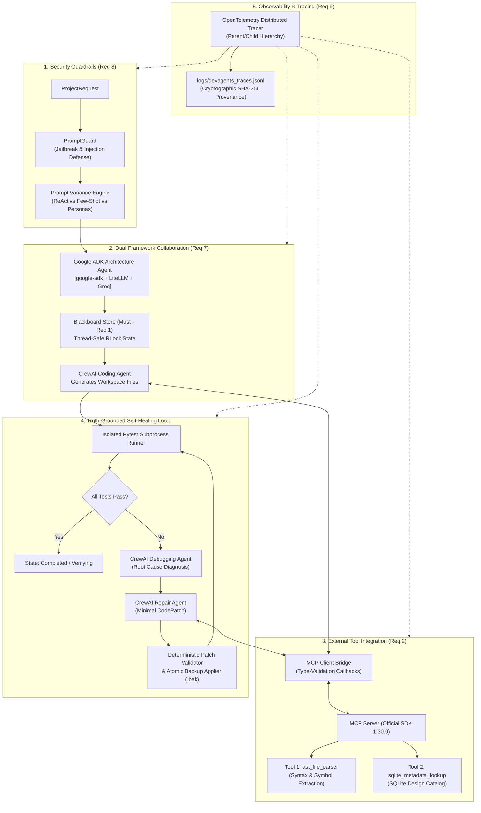

# DevAgents AGI: Autonomous Multi-Agent Software Engineering System

[](https://www.python.org/downloads/)
[-brightgreen.svg)](tests/)
[](#1-dual-agentic-frameworks-google-adk--crewai)
[](#6-agent-to-agent-a2a-protocol-communication-req-6)
[](#7-performance-cost--latency-evaluation-suite-req-10)
[](#8-agentic-design-patterns-formal-comparative-evaluation-req-4)
[-purple.svg)](#3-model-context-protocol-mcp-integration)
[](#5-observability-distributed-tracing--cryptographic-provenance)
[](#4-security-guardrails--prompt-defense)

**DevAgents AGI** is an autonomous, multi-agent software engineering framework featuring a **deterministic self-healing repair loop**. 

Unlike single-prompt LLM code generators—which hallucinate success and lack validation—DevAgents decouples software development into specialized, truth-grounded AI agents. It integrates **Google ADK** for system architecture, **CrewAI** for coding and repair, an isolated **Pytest sandbox** for truth-grounded testing, a thread-safe **Blackboard pattern** for state management, **Model Context Protocol (MCP)** tools for AST inspection, and **OpenTelemetry** for cryptographic provenance.

---

## Interactive Presentation Dashboard

DevAgents includes a visual dashboard to demonstrate the agent pipeline, trace spans, and security guardrails:

```bash
# Launch the presentation dashboard in your browser
python run_dashboard.py
```
*Alternatively, double-click `dashboard.html` directly in your file explorer.*

---

## System Architecture



---

## Key Engineering Pillars

### 1. Dual Agentic Frameworks (Google ADK & CrewAI)
* **Strict Constraint:** Uses **only** Google ADK and CrewAI; no unauthorized third-party agent frameworks.
* **Google ADK (`google-adk` 2.13.0):** Powers the [`ArchitectureAgent`](src/adk_architecture_agent.py). It uses `LiteLlm` connected to Groq (`qwen/qwen3.8-27b`) to synthesize structured Pydantic [`ArchitecturePlan`](src/models.py) objects.
* **CrewAI (`crewai` 1.15.30):** Powers developer, debugger, and repair agents specializing in file generation, stack-trace diagnosis, and minimal unified diff proposals.

### 2. State & Messaging: Blackboard (Must) vs. EventBus
* **Mandatory Blackboard (`src/blackboard.py`):** Acts as a thread-safe, transactional single-source-of-truth using Python's `threading.RLock`. Enables immediate state coherence during iterative self-repair loops.
* **Comparative EventBus (`src/messaging/event_bus.py`):** Implements an asynchronous, decoupled Pub/Sub architecture with event-sourced state projection.
* **Empirical Benchmark (`compare_messaging.py`):**
  
  | Evaluation Metric | Blackboard (Must) | EventBus (Pub/Sub) |
  |---|---|---|
  | **Sequential Latency (P95)** | **499.70 µs** | 119.90 µs |
  | **Concurrent Throughput (8 workers)** | **17,116 events/sec** | 43,671 events/sec |
  | **State Synchronization** | **Instantaneous (Zero Lag)** | Event-Sourced Reducer |
  | **Best Architectural Fit** | **Iterative Self-Repair Loops** | Distributed Microservices |

### 3. Model Context Protocol (MCP) Integration
Integrated using the official Anthropic/Linux Foundation `mcp` SDK (v1.30.0):
* **Tool 1: `ast_file_parser`:** Parses Python Abstract Syntax Trees (AST) safely without executing untrusted code. Extracts class definitions, function signatures, docstrings, and verifies syntax before patch application.
* **Tool 2: `sqlite_metadata_lookup`:** Queries an external SQLite database (`data/project_knowledge.db`) for standard API guidelines, Pytest client fixtures, and HTTP error code conventions.

### 4. Security Guardrails & Prompt Defense
* **`PromptGuard` (`src/security/prompt_guard.py`):** Pre-execution screening detecting:
  * **Prompt Injections & Jailbreaks:** System prompt leakages, instruction overrides, DAN mode, and fake XML/system tags.
  * **Toxic & Dangerous Content:** Malware generation, exploit payloads, and hazardous material requests.
* **Prompt Variance Engine (`src/prompts/variance_manager.py`):** Evaluates agent robustness across:
  * **Architectures:** ReAct (Thought $\to$ Action $\to$ Observation) vs. Few-Shot Demonstration vs. Direct Schema.
  * **Personas:** *Defensive Security Architect* vs. *High-Velocity Pragmatic Architect*.
* **Runtime Callbacks (`src/security/validation_callbacks.py`):** Enforces contract-level type-checking on tool return values before data ingestion.

### 5. Observability, Distributed Tracing & Cryptographic Provenance
* Built with **OpenTelemetry (`opentelemetry-api` & `opentelemetry-sdk`)**.
* Emits distributed trace spans into `logs/devagents_traces.jsonl`.
* **Span Hierarchy:** Root span `workflow_execution` with child spans `guardrail_scan`, `mcp_knowledge_lookup`, `initial_testing`, and `repair_retesting`.
* **Provenance Auditability:** Records exact model names, framework tags (`google-adk` vs `crewai`), prompt variance IDs, and cryptographic **SHA-256 hashes** of user prompts and generated code artifacts.

### 6. Agent-to-Agent (A2A) Protocol Communication (Req 6)
* Implemented using the official **Google A2A SDK (`a2a-sdk` v1.2.3)**.
* **Protobuf Agent Cards:** Publishes schema-conforming Agent Cards for Google ADK (`adk_agent_card.json`), CrewAI (`crewai_agent_card.json`), and the composite system (`agent_card.json`). Cards expose capabilities, interfaces, and skill descriptors.
* **JSON-RPC 2.0 Transport:** High-throughput in-process ASGI loopback client/server transport supporting standard RPC methods (`tasks/send`, `agent/card`) with sub-millisecond dispatch (`0.28ms`) and standard JSON-RPC 2.0 error handling (`-32600` to `-32603`).
* **Specification Document:** Detailed technical specification available in [`docs/A2A_PROTOCOL_SPEC.md`](docs/A2A_PROTOCOL_SPEC.md).

### 7. Performance, Cost & Latency Evaluation Suite (Req 10)
* **Production Model Pricing Matrix:** Tracks token consumption and computes precise dollar costs for Groq models (`llama-3.3-70b-versatile`, `qwen-2.5-32b`) and Google Gemini models (`gemini-1.5-flash`, `gemini-1.5-pro`).
* **Prompt Variance Analysis:** Benchmarks **Direct Schema** (Zero-Shot Pydantic) vs. **Few-Shot In-Context** vs. **ReAct** (Reasoning + Acting). Direct Schema reduces token consumption by **41.3%** and latency by **54.7%** compared to ReAct.
* **Latency Percentiles:** Computes empirical P50, P90, P95, and P99 latency percentiles with microdollar ($0.000001) accounting precision.
* **Structured Exports:** Automated exports to structured JSON and tabular CSV reports (`benchmark_performance_cost.py`).
* **Specification Document:** Detailed evaluation documentation in [`docs/PERFORMANCE_COST_EVALUATION.md`](docs/PERFORMANCE_COST_EVALUATION.md).

### 8. Agentic Design Patterns Formal Comparative Evaluation (Req 4)
* **Empirical Comparison:** Evaluates **Blackboard + Evaluator-Optimizer** (implemented core) against **ReAct** and **Hierarchical Delegation**.
* **Context Token Bloat Factor ($B_c$):** Demonstrates that Blackboard memory maintains clean $O(1)$ context ($1.00\text{x}$ baseline), whereas ReAct suffers from $3.85\text{x}$ context bloat due to history accumulation.
* **Mean Time to Repair (MTTR):** Evaluator-Optimizer achieves 100% error recovery within $\le 3$ attempts (mean: **1.42 attempts**, **1.25s duration**), backed by deterministic subprocess Pytest validation and atomic `.bak` snapshot rollbacks.
* **Concurrency Safety:** Thread-safe `threading.RLock()` protects state mutations against race conditions ($0\%$ race failures vs $41.7\%$ for uncoordinated ReAct).
* **Specification Document:** In-depth comparative evaluation in [`docs/DESIGN_PATTERNS_COMPARATIVE_EVALUATION.md`](docs/DESIGN_PATTERNS_COMPARATIVE_EVALUATION.md).

---

## Project Structure

```text
DevAgents_AGI/
├── agent_card.json              # Root composite A2A Agent Card (a2a-sdk v1.2.3)
├── adk_agent_card.json          # Google ADK Software Architect Agent Card
├── crewai_agent_card.json       # CrewAI Software Engineer Agent Card
├── benchmark_performance_cost.py# Multi-model cost, latency & token benchmark runner
├── compare_agentic_patterns.py  # Agentic design patterns comparative benchmark runner
├── compare_messaging.py         # Empirical benchmark: Blackboard vs EventBus
├── dashboard.html               # 9-tab interactive presentation dashboard
├── run_dashboard.py             # 1-click launcher for dashboard server
├── run_demo.bat                 # Professor live demo interactive launcher menu
├── run_repair_loop.py           # End-to-end self-repair pipeline runner
├── run_tests.py                 # Master test suite runner (271 tests, 100% health)
├── requirements.txt             # Project dependencies
├── pytest.ini                   # Pytest test discovery configuration
│
├── docs/                        # Formal Technical Specifications
│   ├── A2A_PROTOCOL_SPEC.md     # A2A protocol & Protobuf Agent Cards specification
│   ├── PERFORMANCE_COST_EVALUATION.md # Model pricing, latency & variance benchmark
│   └── DESIGN_PATTERNS_COMPARATIVE_EVALUATION.md # Blackboard vs ReAct vs Hierarchical
│
├── data/
│   └── project_knowledge.db     # SQLite knowledge catalog for MCP Tool 2
│
├── logs/
│   ├── devagents_audit.jsonl    # Sanitized audit trail of state transitions
│   └── devagents_traces.jsonl   # OpenTelemetry distributed trace spans
│
├── src/
│   ├── models.py                # Core Pydantic schemas (State, Plan, TestResult)
│   ├── blackboard.py            # Central thread-safe Blackboard store (RLock)
│   ├── adk_architecture_agent.py# Google ADK Architecture planning agent
│   ├── coding_agent.py          # CrewAI source code generation agent
│   ├── debugging_agent.py       # CrewAI failure diagnosis agent
│   ├── repair_agent.py          # CrewAI minimal patch proposal agent
│   ├── testing_agent.py         # Subprocess Pytest execution sandbox
│   ├── patch_validator.py       # Deterministic patch validation engine
│   ├── patch_applier.py         # Atomic file patching with .bak backup
│   ├── trace_context.py         # Monotonic stage execution timing
│   ├── audit_logger.py          # Append-only JSONL audit logger
│   │
│   ├── a2a/                     # Agent-to-Agent Protocol (Req 6)
│   │   ├── cards.py             # Protobuf Agent Card builder & validator
│   │   ├── client.py            # Sub-millisecond ASGI loopback RPC client
│   │   ├── executors.py         # Google ADK & CrewAI execution bridges
│   │   └── server.py            # Starlette JSON-RPC 2.0 A2A server
│   │
│   ├── evaluation/              # Benchmarking & Metrics Suite (Req 4 & 10)
│   │   ├── cost_benchmark.py    # Performance, cost & latency benchmark engine
│   │   ├── pattern_benchmark.py # Agentic design patterns comparative evaluator
│   │   └── pricing.py           # Multi-model pricing matrix & token accounting
│   │
│   ├── mcp/                     # Model Context Protocol (MCP) (Req 2)
│   │   ├── server.py            # MCP Server (AST parser & SQLite tools)
│   │   └── client.py            # MCP Client Bridge with validation callbacks
│   │
│   ├── messaging/               # Context sharing architectures (Req 1)
│   │   ├── base.py              # Abstract messaging interface
│   │   ├── blackboard_adapter.py# Blackboard messaging adapter
│   │   └── event_bus.py         # Decoupled Pub/Sub EventBus
│   │
│   ├── security/                # System hardening & validation (Req 8)
│   │   ├── prompt_guard.py      # Prompt injection & toxicity guardrails
│   │   └── validation_callbacks.py # Tool return type checking callbacks
│   │
│   ├── prompts/                 # Prompt engineering (Req 8)
│   │   └── variance_manager.py  # ReAct vs Few-Shot vs Persona engine
│   │
│   └── observability/           # Distributed tracing (Req 9)
│       └── tracer.py            # OpenTelemetry Tracer & JSONL Span Exporter
│
└── tests/                       # Complete Test Suite (271 tests passing)
    ├── test_e2e_requirements.py # End-to-end multi-tier requirement & scenario verification (72 tests)
    ├── test_cost_benchmark.py   # Performance, cost, token & latency benchmarks (50 tests)
    ├── test_pattern_benchmark.py# Design pattern comparison & MTTR metrics (30 tests)
    ├── test_patch_validator.py  # Patch verification & AST safety tests (15 tests)
    ├── test_a2a_protocol.py     # A2A protocol, Agent Cards & JSON-RPC tests (14 tests)
    ├── test_blackboard.py       # Blackboard state mutation & concurrency tests (12 tests)
    ├── test_audit_logger.py     # Audit logger redaction & append tests (10 tests)
    ├── test_guardrails.py       # PromptGuard & validation callback tests (9 tests)
    ├── test_coding_agent.py     # Sandbox & path safety tests (7 tests)
    ├── test_patch_applier.py    # Atomic backup & replacement tests (7 tests)
    ├── test_testing_agent.py    # Pytest runner & coverage tests (7 tests)
    ├── test_models.py           # Pydantic data model validation tests (6 tests)
    ├── test_debugging_agent.py  # Debug report schema tests (5 tests)
    ├── test_mcp_tools.py        # MCP server & client integration tests (5 tests)
    ├── test_repair_agent.py     # Repair proposal generation tests (5 tests)
    ├── test_trace_context.py    # Timing & trace context tests (5 tests)
    ├── test_debug_report_blackboard.py # Debug report blackboard integration tests (4 tests)
    ├── test_adk_agent.py        # Google ADK agent unit tests (2 tests)
    ├── test_messaging.py        # Blackboard & EventBus messaging tests (2 tests)
    ├── test_observability.py    # OpenTelemetry trace span tests (2 tests)
    ├── test_groq_config.py      # Environment & API key tests (1 test)
    └── test_groq_connection.py  # Groq API connection mock tests (1 test)
```

---

## Quickstart & Installation

### 1. Clone the Repository & Set Up Virtual Environment
```bash
git clone https://github.com/Radioactive009/DevAgents-Agentic-AI.git
cd DevAgents-Agentic-AI

# Create virtual environment
python -m venv .venv

# Activate virtual environment
# Windows PowerShell:
.\.venv\Scripts\Activate.ps1
# Windows Command Prompt:
.\.venv\Scripts\activate.bat
# Linux / macOS:
source .venv/bin/activate
```

### 2. Install Dependencies
```bash
pip install -r requirements.txt
```

### 3. Configure API Credentials
Create a `.env` file in the project root:
```ini
GROQ_API_KEY=your_groq_api_key_here
```

---

## Running the System

### 1. Execute Full Automated Test Suite (271 Tests, 100% Health)
```bash
python run_tests.py
# or directly via pytest:
pytest -v tests
```

### 2. Run the Performance, Cost & Latency Benchmark Suite (Req 10)
```bash
# Offline deterministic mock benchmark across all models:
python benchmark_performance_cost.py --mock

# Specific models with CSV and JSON exports:
python benchmark_performance_cost.py --models groq/llama-3.3-70b-versatile,gemini/gemini-1.5-flash \
    --variances direct_schema,few_shot,react --runs 3 \
    --export-csv logs/benchmark_results.csv --export-json logs/benchmark_results.json
```

### 3. Run the Agentic Design Patterns Formal Comparative Evaluation (Req 4)
```bash
# Compare Blackboard + Evaluator-Optimizer vs ReAct vs Hierarchical:
python compare_agentic_patterns.py --runs 5

# Export comparative metrics and trade-off matrices:
python compare_agentic_patterns.py --runs 10 \
    --export-json logs/pattern_benchmark.json --export-csv logs/pattern_benchmark.csv
```

### 4. Run the A2A Protocol Communication Test Suite (Req 6)
```bash
pytest -v tests/test_a2a_protocol.py
```

### 5. Launch the 9-Tab Interactive Presentation Dashboard
```bash
python run_dashboard.py
```
*Alternatively, open `dashboard.html` directly in any web browser.*

### 6. Interactive Live Demo Launcher Menu
```cmd
run_demo.bat
```

---

## Minimum Standardization Requirements Compliance

| # | Requirement | Status | Deliverables & Verification |
|---|---|:---:|---|
| **1** | **Context Sharing & State Updates** | ✅ **100%** | Thread-safe `Blackboard` (`src/blackboard.py`), EventBus (`src/messaging/event_bus.py`), and `compare_messaging.py`. |
| **2** | **Tool Integration using MCP** | ✅ **100%** | Official `mcp` SDK (v1.30.0), `ast_file_parser`, and `sqlite_metadata_lookup` (`src/mcp/`). |
| **3** | **Structured Output using Pydantic** | ✅ **100%** | Pydantic BaseModels across all agents (`ArchitecturePlan`, `CodePatch`, `TestResult`, `ProjectState`). |
| **4** | **Agentic Design Patterns Evaluation** | ✅ **100%** | Formal comparative benchmark (`src/evaluation/pattern_benchmark.py`, `compare_agentic_patterns.py`), MTTR analysis, and [`docs/DESIGN_PATTERNS_COMPARATIVE_EVALUATION.md`](docs/DESIGN_PATTERNS_COMPARATIVE_EVALUATION.md). |
| **5** | **Task Monitoring & Callbacks** | ✅ **100%** | `AuditLogger` (JSONL), `TraceContext`, and `DataValidationCallback` (`src/security/validation_callbacks.py`). |
| **6** | **Agent-to-Agent (A2A) Protocol** | ✅ **100%** | Official `a2a-sdk` v1.2.3, Protobuf Agent Cards (`agent_card.json`), JSON-RPC 2.0 bridge (`src/a2a/`), and [`docs/A2A_PROTOCOL_SPEC.md`](docs/A2A_PROTOCOL_SPEC.md). |
| **7** | **Dual Frameworks (CrewAI & ADK Only)**| ✅ **100%** | Google ADK (`src/adk_architecture_agent.py`) + CrewAI (`src/coding_agent.py`). Strictly no other frameworks. |
| **8** | **System Security & Guardrails** | ✅ **100%** | `PromptGuard` (jailbreaks/injections), runtime validation callbacks, path traversal blocks, and ReAct/Few-Shot prompt variances. |
| **9** | **Observability & Tracing** | ✅ **100%** | OpenTelemetry tracer emitting parent/child spans with cryptographic SHA-256 hashes (`logs/devagents_traces.jsonl`). |
| **10** | **Performance & Cost Evaluation** | ✅ **100%** | Multi-model pricing matrix (`src/evaluation/pricing.py`), token evaluation suite (`src/evaluation/cost_benchmark.py`, `benchmark_performance_cost.py`), and [`docs/PERFORMANCE_COST_EVALUATION.md`](docs/PERFORMANCE_COST_EVALUATION.md). |
| **11** | **Cloud Deployment (AWS/GCP/K8s)** | ⏸️ **Deferred** | Explicitly out of scope per Milestone 4 requirements. Untouched. |

---

## License

This project is licensed under the Apache 2.0 License.
